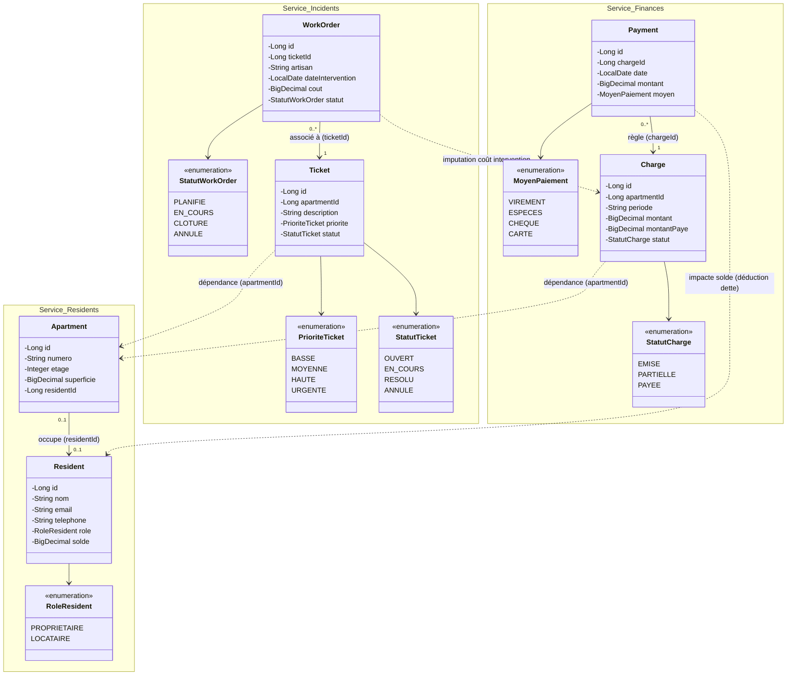

# MyBuilding — Plateforme de Gestion de Copropriété (PFM)

---

## 1. Description du Projet

**MyBuilding** est une application web modulaire et distribuée conçue pour la gestion administrative, technique et financière d’un immeuble en copropriété (syndic). 

Développée selon une **architecture microservices**, l’application répond aux besoins clés du syndic et des copropriétaires :
* **Gestion des résidents et du parc immobilier** : enregistrement des copropriétaires et locataires, gestion des appartements et tenue à jour du solde de chaque résident.
* **Gestion technique et maintenance** : signalement des pannes via des tickets d'incidents, planification des ordres d'intervention (WorkOrders) pour les artisans et suivi des coûts de réparation.
* **Gestion financière et comptable** : émission des appels de charges mensuels par appartement, enregistrement des règlements (partiels ou totaux), contrôle strict des impayés et imputation des dépenses de maintenance au budget.

---

## 2. Diagramme de Classes UML Global

Ce diagramme présente les entités métier de chacun des services de la plateforme, leurs énumérations, leurs relations internes ainsi que les **dépendances inter-services matérialisées par des flèches en pointillés (`..>`)**, indépendantes des protocoles de communication sous-jacents (REST/Feign, Kafka, etc.).

---

## 3. Schéma de l'Architecture (Les 5 Applications et leurs Ports)

L'architecture globale repose sur **cinq applications** interconnectées pour assurer l'enregistrement, la découverte et le routage dynamique :

### Récapitulatif des 5 Applications :

| N° | Application | Nom Spring (`spring.application.name`) | Port | Rôle & Description |
| :-: | :--- | :--- | :---: | :--- |
| **1** | **Eureka Server** | `eureka-server` | **8761** | Annuaire centralisé d'enregistrement et de découverte des services |
| **2** | **API Gateway** | `api-gateway` | **8080** | Passerelle unique avec routage dynamique et Load Balancing |
| **3** | **Service Residents** | `service-residents` | **8081** | Gestion des résidents, des appartements et des soldes |
| **4** | **Service Incidents** | `service-incidents` | **8082** | Gestion des tickets de pannes et des ordres de travail (artisans) |
| **5** | **Service Finances** | `service-finances` | **8083** | Gestion des appels de charges, des paiements et du budget |

---

## 4. Routage Dynamique via l'API Gateway

Toutes les requêtes passent par l'API Gateway sur le port **8080**. Grâce à l'intégration avec Eureka (`lb://`), l'adresse et le port des services cibles sont résolus dynamiquement :

| Domaine Métier | Route d'accès Gateway (Port 8080) | Destination Résolue via Eureka |
| :--- | :--- | :--- |
| **Résidents** | `GET http://localhost:8080/api/residents` | `lb://SERVICE-RESIDENTS/api/residents` |
| **Appartements**| `GET http://localhost:8080/api/apartments` | `lb://SERVICE-RESIDENTS/api/apartments` |
| **Tickets** | `GET http://localhost:8080/api/tickets` | `lb://SERVICE-INCIDENTS/api/tickets` |
| **Ordres de travail** | `GET http://localhost:8080/api/work-orders` | `lb://SERVICE-INCIDENTS/api/work-orders` |
| **Charges** | `GET http://localhost:8080/api/charges` | `lb://SERVICE-FINANCES/api/charges` |
| **Paiements** | `GET http://localhost:8080/api/payments` | `lb://SERVICE-FINANCES/api/payments` |

Routage par Discovery Locator également disponible :  
`http://localhost:8080/<service-name>/...` (ex: `http://localhost:8080/service-residents/api/residents`).

---

## 5. Démarrage et Validation

### Ordre de lancement :
1. **`eureka-server`** (port 8761) — Interface web : [http://localhost:8761](http://localhost:8761)
2. **`service-residents`** (port 8081)
3. **`service-incidents`** (port 8082)
4. **`service-finances`** (port 8083)
5. **`api-gateway`** (port 8080)

Une fois tous les services démarrés, Eureka affiche les 4 clients connectés avec le statut **UP**.

---

## 6. Versionnage Git & Jalon Livré

* **Tag officiel du jalon** : `jalon-1` / `v1.0.0-jalon1`
* **Dépôt GitHub** : [https://github.com/SAADOUARRAD/MyBuilding](https://github.com/SAADOUARRAD/MyBuilding)
