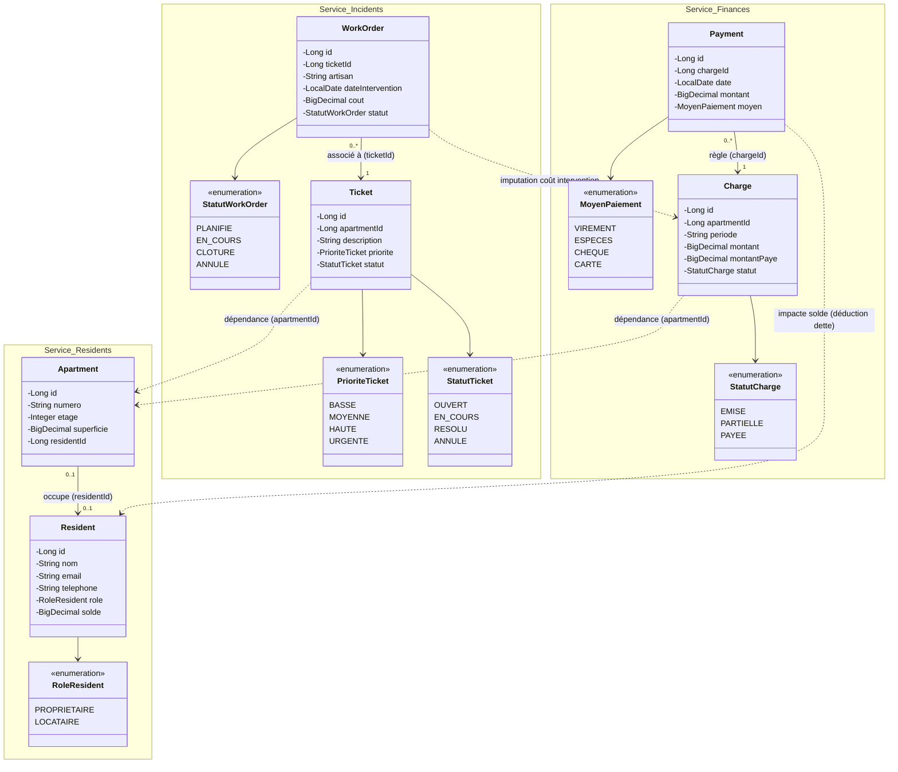
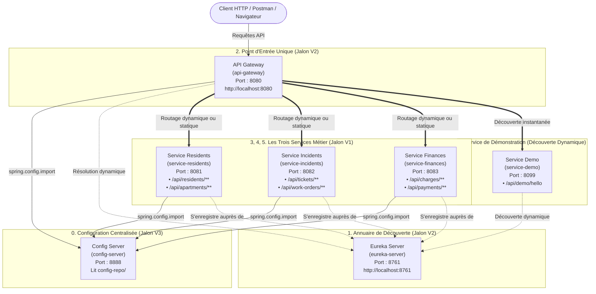

# MyBuilding — Plateforme de Gestion de Copropriété (PFM)

---

## 1. Description du Projet

**MyBuilding** est une application web modulaire et distribuée conçue pour la gestion administrative, technique et financière d’un immeuble en copropriété (syndic). 

Développée selon une **architecture microservices**, l’application répond aux besoins clés du syndic et des copropriétaires :
* **Gestion des résidents et du parc immobilier** : enregistrement des copropriétaires et locataires, gestion des appartements et tenue à jour du solde de chaque résident.
* **Gestion technique et maintenance** : signalement des pannes via des tickets d'incidents, planification des ordres d'intervention (WorkOrders) pour les artisans et suivi des coûts de réparation.
* **Gestion financière et comptable** : émission des appels de charges mensuels par appartement, enregistrement des règlements (partiels ou totaux), contrôle strict des impayés et imputation des dépenses de maintenance au budget.

---

## 2. Diagramme de Classes UML Global

Ce diagramme présente les entités métier de chacun des services de la plateforme, leurs énumérations, leurs relations internes ainsi que les **dépendances inter-services matérialisées par des flèches en pointillés (`..>`)**, indépendantes des protocoles de communication sous-jacents (REST/Feign, Kafka, etc.).



---

## 3. Schéma de l'Architecture (Les 6 Applications et leurs Ports)

L'architecture globale repose sur **six applications Spring Boot** interconnectées pour assurer la centralisation de configuration, l'enregistrement, la découverte et le routage :



### Récapitulatif des Applications :

| N° | Application | Nom Spring (`spring.application.name`) | Port | Rôle & Description |
| :-: | :--- | :--- | :---: | :--- |
| **0** | **Eureka Server** | `eureka-server` | **8761** | Annuaire centralisé d'enregistrement et de découverte *(Config locale)* |
| **1** | **Config Server** | `config-server` | **8888** | Serveur centralisé de configuration Spring Cloud Config *(Config locale)* |
| **2** | **API Gateway** | `api-gateway` | **8080** | Passerelle réactive avec routage dynamique et statique |
| **3** | **Service Residents** | `service-residents` | **8081** | Gestion des résidents, des appartements et des soldes |
| **4** | **Service Incidents** | `service-incidents` | **8082** | Gestion des tickets de pannes et des ordres de travail (artisans) |
| **5** | **Service Finances** | `service-finances` | **8083** | Gestion des appels de charges, des paiements et du budget |
| **6** | **Service Demo** | `service-demo` | **8099** | Preuve de découverte dynamique instantanée sans redémarrage de la Gateway |

---

## 4. Routage API Gateway : Dynamique vs Statique (Jalon V2)

La passerelle implémente les deux modes de routage requis par le **Jalon V2** :

### A. Mode Dynamique (par défaut)
Activé via le Discovery Locator Eureka (`spring.cloud.gateway.discovery.locator.enabled=true`).  
Les routes sont créées automatiquement à partir du nom des services enregistrés dans Eureka :
* **Résidents** : `http://localhost:8080/service-residents/api/residents`
* **Appartements** : `http://localhost:8080/service-residents/api/apartments`
* **Tickets** : `http://localhost:8080/service-incidents/api/tickets`
* **Ordres de travail** : `http://localhost:8080/service-incidents/api/work-orders`
* **Charges** : `http://localhost:8080/service-finances/api/charges`
* **Paiements** : `http://localhost:8080/service-finances/api/payments`

Lancement standard :
```bash
mvn -pl api-gateway spring-boot:run
```

### B. Mode Statique (Profil `statique`)
Désactive le discovery locator (`enabled=false`) et utilise des routes explicites déclarées avec `lb://` sans préfixe de service :
* **Résidents** : `http://localhost:8080/api/residents`
* **Tickets** : `http://localhost:8080/api/tickets`
* **Charges** : `http://localhost:8080/api/charges`

Lancement avec le profil statique :
```bash
mvn -pl api-gateway spring-boot:run -Dspring-boot.run.profiles=statique
```

### C. Démonstration de Découverte Dynamique (`service-demo`)
Pour prouver qu'un nouveau service est immédiatement accessible via la Gateway **sans redémarrer la Gateway et sans ajouter de route** :
1. Démarrer `eureka-server`, `config-server` et `api-gateway`.
2. Démarrer le service de démo :
   ```bash
   mvn spring-boot:run -Pdemo -pl service-demo
   ```
3. Après ~30 secondes (enregistrement Eureka), interroger via la Gateway :
   ```bash
   curl http://localhost:8080/service-demo/api/demo/hello
   ```
   Réponse `200 OK` avec le message de confirmation !

---

## 5. Centralisation des Configurations (Jalon V3 - Spring Cloud Config)

Le dossier centralisé versionné `config-repo/` contient la configuration de tous les microservices clients :
* `config-repo/application.properties` : Propriétés partagées (URL Eureka, Actuator).
* `config-repo/service-residents.properties` : Port 8081, BDD H2 `residentsdb`, JPA Hibernate.
* `config-repo/service-incidents.properties` : Port 8082, BDD H2 `incidentsdb`, JPA Hibernate.
* `config-repo/service-finances.properties` : Port 8083, BDD H2 `financesdb`, JPA Hibernate.
* `config-repo/api-gateway.properties` : Port 8080, Discovery Locator et Actuator Gateway.

### Configuration locale minimale & Fail-Fast :
Chaque service client n'a plus qu'un fichier local minimal `src/main/resources/application.properties` :
```properties
spring.application.name=service-residents
spring.config.import=configserver:http://localhost:8888
```
*(L'absence du préfixe `optional:` garantit le **Fail-Fast** : si le Config Server est inaccessible, le microservice s'arrête immédiatement).*

---

## 6. Ordre de Démarrage et Validation

### Ordre de lancement strict :
1. **`eureka-server`** (port 8761) — Annuaire de découverte *(Config locale)*
2. **`config-server`** (port 8888) — Serveur de configuration *(Config locale)*
3. **`service-residents`** (port 8081) — Charge sa config depuis le port 8888
4. **`service-incidents`** (port 8082) — Charge sa config depuis le port 8888
5. **`service-finances`** (port 8083) — Charge sa config depuis le port 8888
6. **`api-gateway`** (port 8080) — Charge sa config depuis le port 8888

---

## 7. Communication Synchrone Inter-Services (Jalon V4 - OpenFeign)

Le Jalon V4 implémente la communication synchrone directe entre microservices via **Spring Cloud OpenFeign** et **Spring Cloud LoadBalancer** (nom d'enregistrement Eureka direct, sans transiter par la Gateway).

### A. Clients OpenFeign Fortement Typés & DTO Dédiés
* **`service-incidents`** :
  * Client : `ResidentsFeignClient` (`@FeignClient(name = "service-residents")`)
  * DTOs dédiés : `ApartmentDTO`, `ResidentDTO`
  * Validation préalable : lors de la création d'un Ticket (`POST /api/tickets`), appel Feign vers `GET /api/apartments/{id}` pour valider l'existence de l'appartement avant insertion. Si l'appartement est inexistant, levée d'une exception 404.
* **`service-finances`** :
  * Client : `ResidentsFeignClient` (`@FeignClient(name = "service-residents")`)
  * DTOs dédiés : `ApartmentDTO`, `ResidentDTO`
  * Validation préalable : lors de l'émission d'une Charge (`POST /api/charges`), validation préalable de l'appartement via Feign.
  * Mise à jour distante : lors de l'enregistrement d'un Règlement (`POST /api/payments`), appel `PATCH /api/residents/{id}/solde` via Feign pour débiter le solde du résident en cohérence.

### B. Agrégation et Consultation Enrichie (DTOs Composés)
Chaque service expose un endpoint de consultation enrichie retournant un **DTO composé** combinant les données locales et les données distantes collectées via OpenFeign :
* **`GET /api/tickets/{id}/detail`** : retourne `TicketResponseFullDTO` (ticket local + numéro appartement, étage, superficie + nom, email, téléphone, rôle du résident).
* **`GET /api/work-orders/{id}/detail`** : retourne `WorkOrderResponseFullDTO` (intervention locale + description du ticket + appartement + résident).
* **`GET /api/charges/{id}/detail`** : retourne `ChargeResponseFullDTO` (charge locale + numéro appartement, étage, superficie + nom, email, téléphone du résident).

### C. Gestion Centralisée des Erreurs Feign (`GlobalExceptionHandler`)
Conformément au barème d'évaluation V4 :
* `IllegalArgumentException` -> **400 Bad Request**
* `FeignException.NotFound` -> **404 Not Found** (ressource distante introuvable)
* `FeignException` avec statut `-1` ou `503` -> **503 Service Unavailable** (service distant arrêté / injoignable)
* Autre `FeignException` -> **502 Bad Gateway**

---

## 8. Versionnage Git & Jalons Livrés

* **Jalon V0 & V1** : Tags `v1.0` / `jalon-1`
* **Jalon V2 & V3** : Tag `v3.0.0-jalon3`
* **Jalon V4** : Tag `v4.0.0-jalon4` (Communication synchrone OpenFeign & DTOs composés)
* **Dépôt GitHub** : [https://github.com/SAADOUARRAD/MyBuilding](https://github.com/SAADOUARRAD/MyBuilding)
