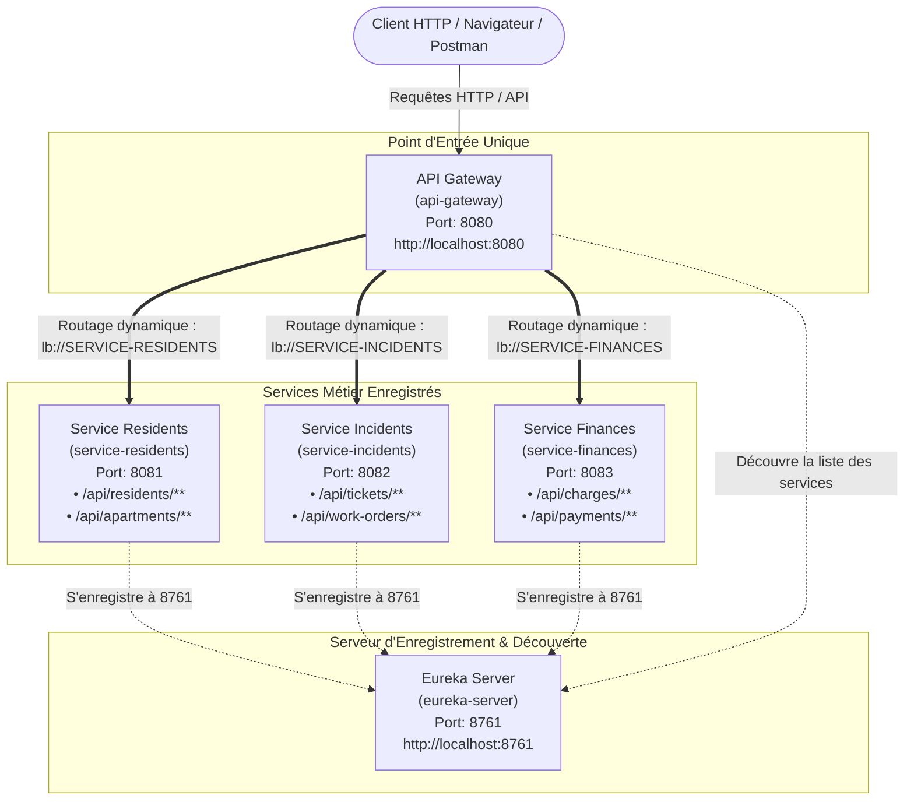

# MyBuilding — Architecture Microservices (Jalon 1)

Ce projet implémente l'architecture microservices pour l'application **MyBuilding** (gestion administrative, technique et financière d'une copropriété).

---

## 1. Schéma d'Architecture Actualisé (Jalon 1)

Ce schéma illustre l'intégration du serveur de découverte **Netflix Eureka** et de l'**API Gateway** avec les trois services métier opérationnels.

---

## 2. Cartographie des Applications & des Ports

| Application | Nom Spring (`spring.application.name`) | Port | Rôle & Description | URL Directe |
| :--- | :--- | :---: | :--- | :--- |
| **Eureka Server** | `eureka-server` | **8761** | Annuaire centralisé des services (Service Registry & Discovery) | [http://localhost:8761](http://localhost:8761) |
| **API Gateway** | `api-gateway` | **8080** | Point d'entrée unique, équilibrage de charge et routage dynamique | [http://localhost:8080](http://localhost:8080) |
| **Service Residents** | `service-residents` | **8081** | Gestion des résidents et des appartements | [http://localhost:8081/api/residents](http://localhost:8081/api/residents) |
| **Service Incidents** | `service-incidents` | **8082** | Gestion des tickets d'incidents et ordres de travail (maintenance) | [http://localhost:8082/api/tickets](http://localhost:8082/api/tickets) |
| **Service Finances** | `service-finances` | **8083** | Gestion des charges de copropriété, règlements et paiements | [http://localhost:8083/api/charges](http://localhost:8083/api/charges) |

---

## 3. Routage Dynamique via l'API Gateway

L'accès à toutes les ressources métier s'effectue via le port unique de la Gateway (`8080`). La Gateway interroge dynamiquement Eureka pour localiser l'adresse et le port des instances disponibles (`lb://<NOM-DU-SERVICE>`).

### 3.1. Routes Métier Spécifiques :
| Domaine Métier | Route Gateway (Port 8080) | Destination Résolue via Eureka |
| :--- | :--- | :--- |
| **Résidents** | `GET http://localhost:8080/api/residents` | `lb://SERVICE-RESIDENTS/api/residents` |
| **Appartements**| `GET http://localhost:8080/api/apartments` | `lb://SERVICE-RESIDENTS/api/apartments` |
| **Tickets** | `GET http://localhost:8080/api/tickets` | `lb://SERVICE-INCIDENTS/api/tickets` |
| **Ordres de travail** | `GET http://localhost:8080/api/work-orders` | `lb://SERVICE-INCIDENTS/api/work-orders` |
| **Charges** | `GET http://localhost:8080/api/charges` | `lb://SERVICE-FINANCES/api/charges` |
| **Paiements** | `GET http://localhost:8080/api/payments` | `lb://SERVICE-FINANCES/api/payments` |

### 3.2. Routage par Découverte Automatique (Discovery Locator) :
Grâce à `spring.cloud.gateway.discovery.locator.enabled: true`, les services sont également accessibles directement par leur identifiant Eureka :
- `http://localhost:8080/service-residents/...`
- `http://localhost:8080/service-incidents/...`
- `http://localhost:8080/service-finances/...`

---

## 4. Ordre de Démarrage Recommandé

Pour un fonctionnement optimal, démarrez les services dans l'ordre suivant :
1. **`eureka-server`** (attendre ~5 secondes que l'annuaire soit prêt sur `http://localhost:8761`)
2. **`service-residents`** (port 8081)
3. **`service-incidents`** (port 8082)
4. **`service-finances`** (port 8083)
5. **`api-gateway`** (port 8080)

Une fois démarré, ouvrez le tableau de bord Eureka sur [http://localhost:8761](http://localhost:8761) : vous devez voir les 4 instances (`API-GATEWAY`, `SERVICE-RESIDENTS`, `SERVICE-INCIDENTS`, `SERVICE-FINANCES`) avec le statut **UP**.

---

## 5. Dépôt Git & Identification de la Livraison

Ce premier jalon est tagué sur Git :
- Tag : **`jalon-1`** (et **`v1.0.0-jalon1`**)
- Message : *Livrable Jalon 1 : Eureka Server, API Gateway dynamique et services métier enregistrés*
